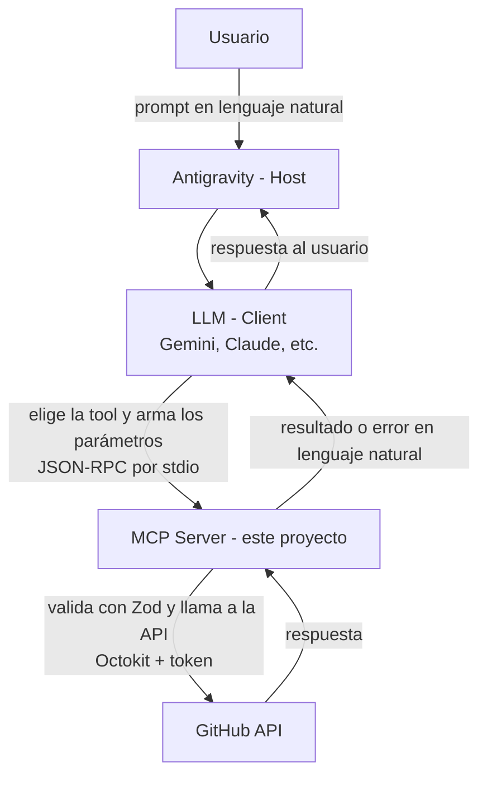

# GitHub MCP Server

MCP Server en Node.js + TypeScript que le permite a un agente de IA (Gemini, Claude u otro LLM) **automatizar operaciones de GitHub usando lenguaje natural** desde Antigravity.

Le decís al agente *"creá un issue en mi repo ProyectoM5 que diga que falla el login"*, y el agente elige la tool correcta, arma los parámetros y la ejecuta contra la API de GitHub.

> Proyecto Integrador del Módulo 5 (Backend) de Soy Henry.

---

## Índice

- [¿Por qué es útil?](#por-qué-es-útil)
- [Arquitectura](#arquitectura)
- [Requisitos](#requisitos)
- [Instalación](#instalación)
- [Configuración](#configuración)
- [Tools disponibles](#tools-disponibles)
- [Ejemplos de uso](#ejemplos-de-uso)
- [Manejo de errores](#manejo-de-errores)
- [Tests](#tests)
- [Debugging con MCP Inspector](#debugging-con-mcp-inspector)
- [Troubleshooting](#troubleshooting)
- [Estructura del proyecto](#estructura-del-proyecto)
- [Licencia](#licencia)

---

## ¿Por qué es útil?

Tareas repetitivas de GitHub que normalmente requieren entrar a la web o escribir comandos, se resuelven con un pedido en lenguaje natural:

- **Arrancar un proyecto nuevo:** crear el repositorio y su primer archivo sin salir del IDE.
- **Registrar bugs al vuelo:** abrir un issue mientras programás, sin cambiar de ventana.
- **Ponerse al día con un repo:** listar los issues abiertos para saber qué hay pendiente.
- **Documentar rápido:** agregar o actualizar un archivo (por ejemplo `docs/notas.md`) con un commit.
- **Descubrir tus repos:** listar tus repositorios para encontrar el nombre exacto de uno.

---

## Arquitectura



Versión en texto:

```
Antigravity (Host)       gestiona la sesión y conecta los componentes
      ↓
LLM (Client)             lee las descripciones de las tools y decide cuál usar y con qué parámetros
      ↓  JSON-RPC por stdio
MCP Server (este repo)   valida el input con Zod, ejecuta la operación y traduce los errores
      ↓  Octokit + GITHUB_TOKEN
GitHub API               recibe las llamadas autenticadas y devuelve resultados
```

### Capas del código

Cada pedido pasa por estas capas, cada una con una responsabilidad:

| Capa | Archivo | Responsabilidad |
|---|---|---|
| Entry point | `src/server.ts` | Arranca el server MCP, registra las tools y responde `tools/list` y `tools/call` por stdio |
| Tools | `src/tools/*.ts` | Definen nombre, descripción y schema de cada tool. Validan el input y arman la respuesta MCP |
| Schemas | `src/schemas/index.ts` | Contratos de entrada con Zod. Se exportan como JSON Schema para el LLM |
| Operaciones | `src/github/operations.ts` | Hablan con GitHub vía Octokit y devuelven solo los datos útiles (DTOs). Las tools nunca usan Octokit directo |
| Cliente | `src/github/client.ts` | Crea el cliente de Octokit con el token leído del `.env` |
| Errores | `src/errors/index.ts` | Tipos de error custom y traducción de errores HTTP a mensajes en lenguaje natural |
| Utilidades | `src/utils/` | Logging estructurado a stderr y retry con exponential backoff |

**Por qué stdio:** Antigravity arranca el server como un proceso y le habla por stdin/stdout. Por eso **stdout está reservado para JSON-RPC** y todos los logs van a **stderr**: un `console.log` rompería el protocolo.

---

## Requisitos

- **Node.js 22.19 o superior** (el repo incluye un `.nvmrc`)
- **npm** (viene con Node.js)
- Una cuenta de **GitHub** y un **Personal Access Token** (ver [Configuración](#1-obtener-un-github-personal-access-token))
- **Antigravity** como IDE/Host para usar el server con un agente

Verificá tu versión de Node:

```bash
node --version
```

---

## Instalación

**1. Clonar el repositorio**

```bash
git clone https://github.com/sebamachello/ProyectoM5_SebastianMachello.git
cd ProyectoM5_SebastianMachello
```

**2. Instalar dependencias**

```bash
npm install
```

**3. Configurar el token** (ver la sección siguiente)

```bash
cp .env.example .env
# y completar GITHUB_TOKEN en el archivo .env
```

**4. Compilar TypeScript**

```bash
npm run build
```

Esto genera la carpeta `dist/` con el JavaScript que ejecuta Node (`dist/server.js`). **Cada vez que cambies código en `src/`, volvé a correr `npm run build`.**

### Scripts disponibles

| Script | Qué hace |
|---|---|
| `npm run build` | Compila `src/` a `dist/` con TypeScript |
| `npm run dev` | Corre el server en modo desarrollo con `tsx` (sin compilar, se reinicia al guardar) |
| `npm start` | Corre el server compilado (`node dist/server.js`) |
| `npm test` | Corre los tests con Vitest |
| `npm run test:watch` | Corre los tests en modo watch |
| `npm run typecheck` | Revisa los tipos sin generar archivos |

---

## Configuración

### 1. Obtener un GitHub Personal Access Token

1. Entrá a GitHub → foto de perfil → **Settings**.
2. Al final del menú izquierdo: **Developer settings** → **Personal access tokens** → **Tokens (classic)**.
3. **Generate new token** → **Generate new token (classic)**.
4. Poné un nombre (por ejemplo `github-mcp-server`) y una fecha de vencimiento.
5. Marcá los scopes de la tabla de abajo.
6. **Generate token** y **copiá el token** (empieza con `ghp_`). GitHub lo muestra una sola vez.

### 2. Scopes que necesita el token

| Scope | Para qué |
|---|---|
| `repo` | Crear repositorios, issues y commits, y leer repos privados |
| `user` | Leer la información del usuario autenticado |
| `admin:org` | Operar con repositorios de organizaciones |

> Si una tool responde **403** con un mensaje de permisos, lo primero que hay que revisar son los scopes del token, no el código.

### 3. Configurar el archivo `.env`

Copiá el archivo de ejemplo y completá el token:

```bash
cp .env.example .env
```

```env
GITHUB_TOKEN=ghp_tu_token_aca
LOG_LEVEL=info
```

| Variable | Obligatoria | Descripción |
|---|---|---|
| `GITHUB_TOKEN` | Sí | Tu Personal Access Token |
| `LOG_LEVEL` | No | Nivel de logs: `debug`, `info` (por defecto), `warn`, `error` o `silent` |

> ⚠️ **Seguridad:** el `.env` está en `.gitignore` y **nunca** se tiene que subir al repositorio. Si el token se sube por error, aunque lo borres en un commit nuevo sigue visible en el historial: **revocalo en GitHub** y generá uno nuevo.

El server carga el `.env` desde la raíz del proyecto con una **ruta absoluta**, así que lo encuentra aunque Antigravity lo arranque desde otra carpeta.

### 4. Configurar el server en Antigravity

1. Abrí Antigravity y andá a **MCP Servers → Manage → View raw config**. Ese es el archivo de configuración que Antigravity usa de verdad (normalmente `mcp_config.json`).
2. Agregá el server dentro de `mcpServers`, con la **ruta absoluta** a `dist/server.js`:

**Windows:**

```json
{
  "mcpServers": {
    "github-mcp-server": {
      "command": "node",
      "args": ["C:\\ruta\\a\\ProyectoM5_SebastianMachello\\dist\\server.js"]
    }
  }
}
```

**macOS / Linux:**

```json
{
  "mcpServers": {
    "github-mcp-server": {
      "command": "node",
      "args": ["/ruta/a/ProyectoM5_SebastianMachello/dist/server.js"]
    }
  }
}
```

> En JSON, cada `\` de una ruta de Windows se escribe doble (`\\`).

3. Guardá y refrescá los MCP Servers. El server tiene que aparecer en el panel con sus **5 tools**.

**Sobre el token:** como el server lee el `.env` del proyecto, no hace falta poner el token en `mcp_config.json`. Si preferís pasarlo por la configuración, usá interpolación de variables de entorno, **nunca el valor literal**:

```json
"env": { "GITHUB_TOKEN": "${GITHUB_TOKEN}" }
```

**Verificar que funciona:** pedile al agente *"Listá mis repositorios de GitHub"*. Si responde con tu lista de repos, está todo conectado.

---

## Tools disponibles

| Tool | Qué hace | Tipo |
|---|---|---|
| [`list_repositories`](#list_repositories) | Lista tus repositorios | Lectura |
| [`create_repository`](#create_repository) | Crea un repositorio nuevo | Escritura |
| [`create_issue`](#create_issue) | Abre un issue en un repositorio | Escritura |
| [`list_issues`](#list_issues) | Lista los issues de un repositorio | Lectura |
| [`create_commit`](#create_commit) | Crea o modifica un archivo con un commit | Escritura |

> **Tip:** si no sabés el `owner` o el nombre exacto de un repo, pedile al agente que primero liste tus repositorios. Las descripciones de las tools ya lo sugieren.

---

### `list_repositories`

Lista los repositorios del usuario dueño del token. Sirve para descubrir qué repos existen y obtener el `owner` y el nombre exacto antes de crear issues o commits. Solo lectura.

| Parámetro | Tipo | Requerido | Descripción |
|---|---|---|---|
| `type` | `"all"` \| `"public"` \| `"private"` | No | Qué repos listar. Por defecto `"all"` |
| `sort` | `"created"` \| `"updated"` \| `"pushed"` \| `"full_name"` | No | Orden del listado. Por defecto `"updated"` |
| `per_page` | entero (1 a 100) | No | Cantidad de repos. Por defecto `20` |

**Prompts de ejemplo:**

- *"Listá mis repositorios de GitHub"*
- *"Mostrame mis 5 repositorios privados creados más recientemente"*

**Respuesta (ejemplo):**

```json
{
  "count": 1,
  "repositories": [
    {
      "full_name": "sebamachello/ProyectoM5_SebastianMachello",
      "owner": "sebamachello",
      "name": "ProyectoM5_SebastianMachello",
      "private": false,
      "description": null,
      "html_url": "https://github.com/sebamachello/ProyectoM5_SebastianMachello"
    }
  ]
}
```

---

### `create_repository`

Crea un repositorio nuevo en la cuenta del usuario autenticado. No crea repos en organizaciones. El repositorio se crea con un README inicial (`auto_init`), así que ya puede recibir commits con `create_commit`.

| Parámetro | Tipo | Requerido | Descripción |
|---|---|---|---|
| `name` | string | **Sí** | Entre 3 y 100 caracteres, solo letras, números y guiones. Ej: `mi-proyecto-2` |
| `description` | string | No | Descripción corta del repo. Por defecto vacía |
| `private` | boolean | No | `true` para privado. Por defecto `false` (público) |

**Prompts de ejemplo:**

- *"Creá un repositorio llamado agenda-turnos con la descripción 'App para reservar turnos'"*
- *"Creá un repo privado llamado notas-personales"*

**Respuesta (ejemplo):**

```json
{
  "repository": {
    "full_name": "sebamachello/agenda-turnos",
    "owner": "sebamachello",
    "name": "agenda-turnos",
    "private": false,
    "description": "App para reservar turnos",
    "html_url": "https://github.com/sebamachello/agenda-turnos"
  }
}
```

> Un nombre como `"mi repo"` (con espacio) se rechaza **antes** de llamar a GitHub, con un mensaje que explica el formato correcto.

---

### `create_issue`

Abre un issue nuevo en un repositorio. Antes de crearlo verifica que el repo exista y tenga los issues activados. No modifica ni cierra issues existentes.

| Parámetro | Tipo | Requerido | Descripción |
|---|---|---|---|
| `owner` | string | **Sí** | Usuario u organización dueña del repo. Ej: `octocat` |
| `repo` | string | **Sí** | Nombre del repo, sin el owner. Ej: `mi-repositorio` |
| `title` | string (3 a 256 caracteres) | **Sí** | Título del issue |
| `body` | string (hasta 65.000 caracteres) | No | Descripción del issue en Markdown |
| `labels` | string[] (hasta 10) | No | Etiquetas que **ya existen** en el repo. Ej: `["bug"]` |

**Prompts de ejemplo:**

- *"Creá un issue en sebamachello/ProyectoM5_SebastianMachello titulado 'El login falla en mobile' con el body 'Al iniciar sesión desde el celular aparece un error 500'"*
- *"Abrí un issue con el label bug en mi repo agenda-turnos que diga que no se guardan los turnos del sábado"*

**Respuesta (ejemplo):**

```json
{
  "issue": {
    "number": 3,
    "title": "El login falla en mobile",
    "state": "open",
    "html_url": "https://github.com/sebamachello/ProyectoM5_SebastianMachello/issues/3",
    "labels": []
  }
}
```

---

### `list_issues`

Lista los issues de un repositorio. Por defecto solo los abiertos. Excluye los pull requests (la API de GitHub los mezcla con los issues). Solo lectura.

| Parámetro | Tipo | Requerido | Descripción |
|---|---|---|---|
| `owner` | string | **Sí** | Usuario u organización dueña del repo |
| `repo` | string | **Sí** | Nombre del repo, sin el owner |
| `state` | `"open"` \| `"closed"` \| `"all"` | No | Qué issues listar. Por defecto `"open"` |
| `per_page` | entero (1 a 100) | No | Cantidad de issues. Por defecto `20` |

**Prompts de ejemplo:**

- *"¿Qué issues abiertos tiene mi repo ProyectoM5_SebastianMachello?"*
- *"Listá los últimos 10 issues cerrados de sebamachello/agenda-turnos"*

**Respuesta (ejemplo):**

```json
{
  "count": 1,
  "issues": [
    {
      "number": 3,
      "title": "El login falla en mobile",
      "state": "open",
      "html_url": "https://github.com/sebamachello/ProyectoM5_SebastianMachello/issues/3",
      "labels": ["bug"]
    }
  ]
}
```

---

### `create_commit`

Crea o modifica **un** archivo de texto en un repositorio haciendo un commit. Si el archivo ya existe, lo **reemplaza completo**. Si no se indica la rama, usa la rama principal del repo.

| Parámetro | Tipo | Requerido | Descripción |
|---|---|---|---|
| `owner` | string | **Sí** | Usuario u organización dueña del repo |
| `repo` | string | **Sí** | Nombre del repo, sin el owner |
| `path` | string | **Sí** | Ruta del archivo desde la raíz del repo, **sin `/` al inicio ni `..`**. Ej: `docs/notas.md` |
| `content` | string | **Sí** | Contenido del archivo en **texto normal** (el server lo convierte a base64) |
| `message` | string | **Sí** | Mensaje del commit |
| `branch` | string | No | Rama destino. Por defecto, la rama principal del repo |

**Prompts de ejemplo:**

- *"Agregá el archivo docs/notas.md con el contenido 'Notas del sprint 1' en mi repo ProyectoM5_SebastianMachello, con el mensaje 'docs: agregar notas del sprint'"*
- *"En sebamachello/agenda-turnos, en la rama dev, creá el archivo TODO.md con la lista: login, turnos, notificaciones. Commit: 'agregar TODO'"*

**Respuesta (ejemplo):**

```json
{
  "commit": {
    "commit_sha": "a8df1b2c7e...",
    "commit_url": "https://github.com/sebamachello/ProyectoM5_SebastianMachello/commit/a8df1b2c7e...",
    "branch": "main",
    "path": "docs/notas.md",
    "file_url": "https://github.com/sebamachello/ProyectoM5_SebastianMachello/blob/main/docs/notas.md"
  }
}
```

> Si otra persona hace un commit en la misma rama mientras se crea el tuyo, GitHub lo rechaza y no se pisa nada. Se vuelve a ejecutar la tool y parte del commit nuevo.

---

## Ejemplos de uso

Un flujo completo que usa las 5 tools, tal como se le puede pedir al agente en Antigravity:

1. **"Creá un repositorio llamado demo-mcp con la descripción 'Prueba del MCP Server'"**
   → `create_repository`. Se crea `sebamachello/demo-mcp`.

2. **"Listá mis repositorios ordenados por fecha de creación"**
   → `list_repositories`. `demo-mcp` aparece primero.

3. **"Agregá un README.md en demo-mcp que diga 'Repo de prueba creado desde Antigravity'"**
   → `create_commit`. Se crea el archivo en la rama principal.

4. **"Abrí un issue en demo-mcp titulado 'Agregar instrucciones de instalación'"**
   → `create_issue`. Se crea el issue `#1`.

5. **"¿Qué issues abiertos tiene demo-mcp?"**
   → `list_issues`. Devuelve el issue `#1`.

**Ejemplo de error en lenguaje natural:**

> *"Listá los issues de sebamachello/repo-que-no-existe"*

El agente recibe un error claro y se lo comunica al usuario:

```json
{
  "code": "GITHUB_API_ERROR",
  "message": "El repositorio sebamachello/repo-que-no-existe no fue encontrado. Verifica el nombre e intenta de nuevo.",
  "retryable": false,
  "action": "CHECK_RESOURCE",
  "hint": "Revisá owner y repo (mayúsculas y guiones). Si el repo es privado, el token tiene que tener acceso."
}
```

---

## Manejo de errores

Todos los errores llegan al agente con **la misma forma**, sin stack traces ni datos sensibles:

```json
{
  "code": "VALIDATION_ERROR | AUTH_ERROR | GITHUB_API_ERROR | NETWORK_ERROR | UNKNOWN_ERROR",
  "message": "Qué pasó, en lenguaje natural",
  "retryable": false,
  "action": "Qué hacer: FIX_INPUT | ADD_CREDENTIALS | WAIT_AND_RETRY | CHECK_RESOURCE | CONTACT_SUPPORT",
  "hint": "Sugerencia concreta para resolverlo",
  "details": {}
}
```

| Tipo de error | `code` | Cuándo ocurre | ¿Se reintenta? |
|---|---|---|---|
| `ValidationError` | `VALIDATION_ERROR` | El input no cumple el schema de Zod. **No se llama a GitHub** | No |
| `AuthenticationError` | `AUTH_ERROR` | Token ausente, inválido o vencido (401) | No |
| `GitHubAPIError` | `GITHUB_API_ERROR` | GitHub rechaza el pedido: 403, 404, 409, 410, 422, 5xx o rate limit | Solo rate limit y 5xx |
| `NetworkError` | `NETWORK_ERROR` | El pedido no llegó a GitHub (sin internet, timeout, DNS) | Sí (salvo en escrituras) |

### Retry con exponential backoff

Los errores transitorios se reintentan con esperas crecientes (1 s, 2 s, 4 s), con un **máximo de 3 reintentos** y un tope de 10 s por espera. Si GitHub indica cuánto esperar (header `Retry-After`), se respeta ese valor.

En las operaciones que **escriben** (crear repo, issue o commit) solo se reintenta el **rate limit**: un error de red puede llegar después de que GitHub ya creó el recurso, y reintentar lo duplicaría.

### Logging

Los logs se escriben en **stderr** en formato JSON, con niveles (`debug`, `info`, `warn`, `error`) configurables con `LOG_LEVEL`. Nunca se loguea el token, y los textos largos de los argumentos (por ejemplo, el contenido de un archivo) se recortan.

```json
{"ts":"2026-11-10T14:36:34.220Z","level":"info","msg":"tool llamada","tool":"list_repositories","args":{"type":"all","sort":"created","per_page":20}}
```

---

## Tests

```bash
npm test
```

Los tests **no llaman a la API real de GitHub** ni usan tokens: son rápidos y siempre dan el mismo resultado.

| Archivo | Qué prueba | Tipo | Tests |
|---|---|---|---|
| `tests/tools.test.ts` | Schemas de Zod: inputs válidos pasan e inválidos fallan (nombre de repo con espacios, demasiado corto, `per_page` fuera de rango y path con `..` en `create_commit`) | Unit | 5 |
| `tests/errors.test.ts` | Transformación de errores: un 404 produce el mensaje en lenguaje natural y un 401 se convierte en `AuthenticationError` | Unit | 2 |
| `tests/github.test.ts` | Operaciones con **Octokit mockeado**: transformación de la respuesta a DTO y manejo de un repo inexistente | Integration | 2 |

### Estrategia de testing

- **Pirámide de testing:** muchos tests unitarios (schemas y funciones puras), tests de integración con dependencias simuladas, y una verificación **manual** con MCP Inspector para comprobar que todo está conectado. No hay tests automáticos contra GitHub real.
- **Inyección de dependencias en vez de `vi.mock()`:** `createGitHubOperations(octokit, retry)` recibe el cliente por parámetro. En producción, `server.ts` le pasa el Octokit real; en los tests, uno falso armado con `vi.fn()`. Esto es posible porque `client.ts` está separado de `operations.ts`.
- Los reintentos se configuran en 0 en los tests para que no esperen.

---

## Debugging con MCP Inspector

Para probar el server sin un agente, compilá y abrí el Inspector:

```bash
npm run build
npx @modelcontextprotocol/inspector node dist/server.js
```

Se abre en el navegador. Conectá el server, andá a **Tools → List Tools** y ejecutá cualquier tool con **Run Tool**. Los logs del server (stderr) aparecen en la consola del Inspector.

---

## Troubleshooting

| Problema | Causa probable | Solución |
|---|---|---|
| El server no aparece en Antigravity | Se editó un archivo de configuración que Antigravity no lee | Abrí **MCP Servers → Manage → View raw config** y editá ese archivo |
| `Cannot find module '...dist/server.js'` | No se compiló el proyecto | Corré `npm run build` |
| Los cambios en el código no se reflejan | Antigravity/Inspector ejecutan `dist/`, que quedó viejo | Volvé a correr `npm run build` y reiniciá el server |
| `AUTH_ERROR` en todas las tools | Falta `GITHUB_TOKEN`, está mal copiado o venció | Revisá el `.env` y reiniciá el server. Si venció, generá uno nuevo |
| `GITHUB_API_ERROR` 403 de permisos | El token no tiene los scopes necesarios | Generá un token con `repo`, `user` y `admin:org` |
| `GITHUB_API_ERROR` 403/429 rate limit | Se superó el límite de pedidos de GitHub | Esperá unos minutos: el server ya reintenta con backoff y el `hint` indica cuándo se renueva |
| `GITHUB_API_ERROR` 404 | El repo, la rama o el recurso no existe, o el repo es privado y el token no tiene acceso | Revisá `owner`/`repo` (mayúsculas y guiones). Pedile al agente que liste tus repos |
| `GITHUB_API_ERROR` 409 en `create_commit` | El repo está vacío (sin commits) | Creá un primer archivo desde GitHub (por ejemplo un README) |
| `GITHUB_API_ERROR` 422 en `create_repository` | Ya existe un repo con ese nombre en tu cuenta | Elegí otro nombre |
| `GITHUB_API_ERROR` 422 en `create_issue` | Un label o un usuario que no existe en el repo | Usá solo labels que ya existan |
| `VALIDATION_ERROR` | El input no cumple el schema | Leé `details`: indica qué campo falló y por qué |
| `NETWORK_ERROR` | Sin conexión con GitHub | Revisá tu conexión y reintentá |
| El agente elige la tool equivocada | El prompt es ambiguo | Sé explícito: nombrá el repo con `owner/repo` y qué querés hacer (ver los prompts de ejemplo) |

---

## Estructura del proyecto

```
├── src/
│   ├── server.ts              # Entry point: server MCP, registro de tools, stdio
│   ├── types.ts               # Tipos compartidos (McpTool, DTOs)
│   ├── tools/
│   │   ├── list-repositories.ts
│   │   ├── create-repository.ts
│   │   ├── create-issue.ts
│   │   ├── list-issues.ts
│   │   └── create-commit.ts
│   ├── schemas/
│   │   └── index.ts           # Schemas de Zod de cada tool
│   ├── github/
│   │   ├── client.ts          # Configuración de Octokit
│   │   └── operations.ts      # Operaciones contra la API de GitHub
│   ├── errors/
│   │   └── index.ts           # Errores custom y traducción a lenguaje natural
│   └── utils/
│       ├── logging.ts         # Logger estructurado a stderr
│       └── retry.ts           # Retry con exponential backoff
├── tests/
│   ├── tools.test.ts          # Tests de schemas
│   ├── errors.test.ts         # Tests de transformación de errores
│   └── github.test.ts         # Tests de operaciones con Octokit mockeado
├── .env.example
├── .gitignore
├── package.json
├── tsconfig.json
└── vitest.config.ts
```

---

## Licencia

Distribuido bajo la licencia **MIT**. Ver el archivo [LICENSE](LICENSE).
